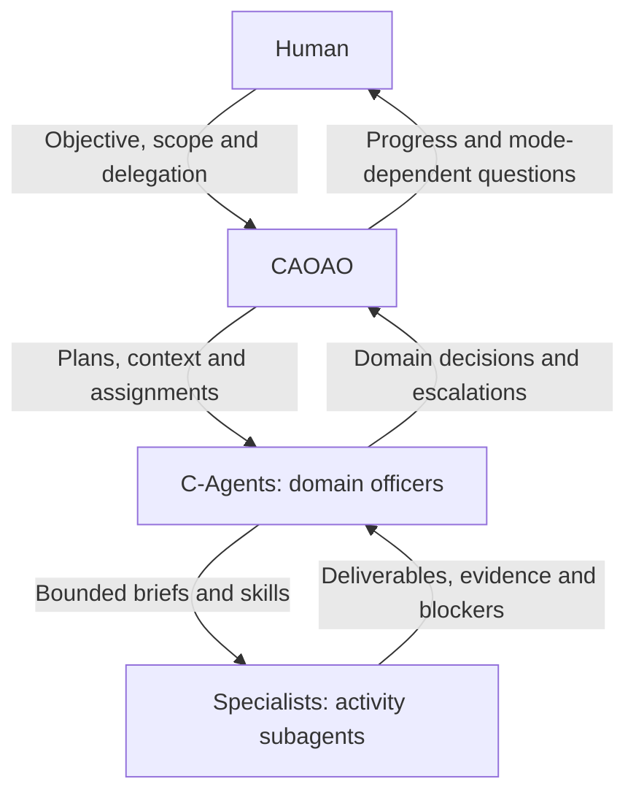

# SPADO — Software Product Agentic Development Organization

> SPADO was previously named **CWI (Claude Workspace Init)**. The repository still uses its original name; it will be renamed in a future version.

SPADO provisions coding agents to work as a **C-organization**: an organization of agents with executive responsibilities, specialist assignments and a shared way of planning, executing and reviewing work.

It configures **Claude Code and Codex** with native agents, skills, workflows and optional tools and MCP integrations. The host runs the agents; SPADO supplies their organizational definitions, operating instructions and shared execution state. The architecture is designed to accommodate other coding agents through additional host adapters.

For setup, everyday operation and **every command and parameter**, use the [usage manual](USAGE.md). Start with its [setup guide](USAGE.md#choose-your-setup) or [first-run walkthrough](docs/manual/first-run.md). The [implementation notes](docs/manual/implementation.md) describe current limits.

## The agentic organization paradigm

SPADO applies an organizational model to software product work. **Chief [Role] Agentic Officers**, collectively called **C-Agents**, lead business and technical domains. Each officer has a mandate: objectives, decision responsibilities, delegation boundaries and required reviews. Specialists carry out bounded assignments and return deliverables with evidence.

An officer maintains direction across the relevant phases and iterations. For example, the Technology officer contributes to feasibility, design, development and operations, commissioning specialist work and reviewing its technical conclusions. Recorded plans, artifacts and decisions preserve continuity between agent sessions.

Every officer and specialist is an agent. **Skills model its behavior**, while authorized tools and MCP integrations provide capabilities. **Workflows coordinate the work** by defining inputs, dependencies, deliverables and decision criteria. The Human sets the objective and delegates authority; the selected mode determines when agents request Human participation.

### Chief [Role] Agentic Officers

The naming convention inserts **A** for **Agentic** immediately before the final **O** of the traditional executive acronym: `CEO → CEAO`, `CTO → CTAO`. Compound roles retain their initials: `CISO → CISAO`.

| Traditional role | C-Agent | Full title | Primary responsibility |
|---|---|---|---|
| CEO | CEAO | Chief Executive Agentic Officer | Business direction, investment and product lifecycle decisions. |
| CPO | CPAO | Chief Product Agentic Officer | Product strategy, discovery, priorities and product acceptance. |
| CTO | CTAO | Chief Technology Agentic Officer | Technical feasibility, architecture, engineering and technical readiness. |
| CMO | CMAO | Chief Marketing Agentic Officer | Positioning, brand, go-to-market strategy and lifecycle marketing. |
| CFO | CFAO | Chief Financial Agentic Officer | Budgets, economic viability, unit economics and financial controls. |
| COO | COAO | Chief Operating Agentic Officer | Service operations, support and operational readiness. |
| CRO | CRAO | Chief Revenue Agentic Officer | Sales strategy, revenue operations and renewals. |
| CISO | CISAO | Chief Information Security Agentic Officer | Security assessment, risk decisions and security response. |
| CLO | CLAO | Chief Legal Agentic Officer | Legal and contractual assessments, coordinating with the privacy owner. |

**CAOAO — Chief Agent Orchestrator Agentic Officer** coordinates this organization. Its role is `Agent Orchestrator`: it maintains the execution plan, distributes context, coordinates dependencies and consolidates outcomes. **CEAO owns business direction; CAOAO coordinates execution across domains.** Each domain officer retains its assigned decision authority.

### How the levels work together



The Human selects the scope and participation mode. CAOAO coordinates the relevant officers, who commission specialist work and review the evidence within their domains. CAOAO consolidates the decisions, checks the applicable gates and updates the shared plan. Cross-domain work requires each responsible officer's conclusion.

For example, when evaluating a product opportunity, CAOAO coordinates **CPAO**, **CTAO** and **CFAO**. Their specialists investigate customer value, technical feasibility and economics. The officers review those findings; CPAO coordinates the product assessment, while CEAO decides material investment or strategic changes where required. CAOAO records the resulting direction and coordinates the next assignments.

## Workflows and participation

The first available workflow is [**Full SPDLC**](catalog/workflows/Full_SPDLC_Workflow.md): 7 phases and 62 reusable subphases covering a software product from idea to retirement. Its organization defines one CAOAO, nine domain officers and 62 specialist assignments. Execution brings in the roles needed for the selected scope.

A user can invoke the full workflow, a phase or a subphase, and resume a selected run or start an independent one. The four modes—**agentic**, **auto**, **semi-auto** and **manual**—control Human checkpoints; the Human can contribute voluntarily in every mode. See [invocations and modes](#work-from-your-agentic-host) below.

Future workflows will use the same organizational model with their own scope and definitions. Skills and other capabilities can also be provisioned independently. See [architecture.md](architecture.md) for the common operating model, authority, agent lifecycle and recording protocol. The current implementation provides CLI services and host configurations; graphical UI and an autonomous agent scheduler are outside v1.

## Start a project

Install Python 3.12+, uv, and Docker with Compose. From this checkout:

```bash
uv sync --group dev
uv tool install -e .
spado --version
```

In the product repository, explicitly choose hosts, execution mode and an embedding provider:

```bash
spado init --host claude --host codex --mode semi-auto \
  --embeddings local --embedding-model sentence-transformers/paraphrase-multilingual-MiniLM-L12-v2 \
  --dry-run
spado init --host claude --host codex --mode semi-auto \
  --embeddings local --embedding-model sentence-transformers/paraphrase-multilingual-MiniLM-L12-v2
spado db up
```

For local embeddings install `spado[local-embeddings]` in the CLI environment: `uv tool install --force -e ".[local-embeddings]"` from this checkout. For development with `uv run spado`, use `uv sync --extra local-embeddings`. The configured model is downloaded when first used. Alternatively select `--embeddings external --embedding-model MODEL` and set `SPADO_EMBEDDING_API_KEY`. The external adapter uses the OpenAI-compatible embeddings request/response contract; `--embedding-endpoint` selects its endpoint. It sends indexed text and search queries to that configured provider.

PostgreSQL/pgvector runs in a project-specific container and persistent volume, bound to localhost. `spado db down` stops it without deleting the volume. Choose `--database-port` on initial setup when multiple projects run simultaneously.

## Work from your agentic host

| Action | Claude Code | Codex |
|---|---|---|
| Whole workflow | `/spdlc --mode auto` | `$spdlc --mode auto` |
| Phase | `/spdlc --phase definition-design --mode manual` | `$spdlc --phase definition-design --mode manual` |
| Subphase | `/spdlc --subphase ui-design --mode semi-auto` | `$spdlc --subphase ui-design --mode semi-auto` |
| State | `/spado --status` | `$spado --status` |
| Review | `/spado --review phase 3` | `$spado --review phase 3` |
| Conversation | `/spado --chat` | `$spado --chat` |

Entry skills translate these requests to SPADO services and native agent delegation. `--run ID` selects an existing execution; `--new-run` asks the host to create an independent execution. The original scope stays intact when advancing within a full workflow. Missing inputs remain visible and provisional outputs cannot be accepted prematurely. Phases progress sequentially by default; subphases follow their input dependencies. Activity means a concrete subphase instance.

Use `spado workflow validate` to list phase and subphase slugs. Numeric IDs such as `3` and `3.5` remain valid.

| Mode | Before execution | Result |
|---|---|---|
| agentic | Agents validate the versioned plan | Domain agents review; no Human approval requests |
| auto | Agents validate; ask the Human only when needed | Same exception-based participation |
| semi-auto | Human approves the plan | Agents review and accept |
| manual | Human approves and chooses human, assisted or delegated work | Human also reviews the result |

Human intervention is always possible. Plans name the deliverable, inputs, actions, assumptions and exit criteria. Modes never override host permissions. Status, review and conversation do not modify files or execution records. Status reports the last recorded state, not guaranteed live process telemetry.

## CLI and evidence

```bash
spado workflow create --objective "Validate a product opportunity" --human
spado actor create CAOAO --run RUN_ID --human
# Give the returned token-file path to the CAOAO session as SPADO_ACTOR_TOKEN_FILE.
spado workflow context --run RUN_ID --subphase initial-ideation --human
spado status --run RUN_ID --human
spado review all --run RUN_ID --human
spado docs sync docs/vision.md --run RUN_ID --human
spado docs promote REVISION_ID --run RUN_ID --human
spado docs index --run RUN_ID --human
spado docs search "product positioning" --run RUN_ID --human
spado workflow export --run RUN_ID --human
```

Use `--human` only for a direct Human action or an explicitly authorized initial delegation. Agent operations use their delegated credentials. Tokens are stored under `.spado/local/`, never included in the event log or printed. Application permissions do not isolate agents from a trusted local administrator who can access database credentials.

Files remain the documentation source of truth. The database preserves immutable revisions and their approval history; editing a file does not replace the approved revision. Synchronization identifies affected recorded consumers and revokes stale gates. Semantic search returns current approved sources; relational state controls dependencies, authority and acceptance. Structural review reports known relationships; the responsible agents must assess semantic contradictions.

The exact write protocol is documented in [the state protocol](src/spado/runtime/protocol.md), installed as `.spado/protocol.md`. `agent-record.py`, installed under `.spado/tools/`, uses the same services. Queries do not synchronize documents; synchronization happens explicitly or before write commands. There is no background filesystem watcher.

## Modular capabilities

The existing catalog of skills, agents, scripts, hooks and MCP remains available:

```bash
spado catalog list
spado catalog validate
spado init --no-workflow --host codex --capability mcp:github
```

`spado init` provisions organizations, or capabilities alone with `--no-workflow`. Optional resources can be added to workflow setup with repeated `--capability TYPE:ID` flags. Dependencies and conflicts are resolved before writing. Host configuration is merged additively; conflicting user edits block installation.

Capabilities use `spado.json` manifests. Imported resources default to Claude compatibility until reviewed; declare `hosts` explicitly to opt into Codex support. Unsupported hooks, agents or host-specific payloads are rejected rather than silently translated. GitHub MCP is available on both hosts.

## Architecture and authoring

See [architecture.md](architecture.md). Author workflow rules and subphase briefs in `catalog/workflows/spdlc/`, organization mandates in `catalog/organizations/spdlc/`, and behavior skills in `catalog/organization-skills/`. The master document is generated:

```bash
spado workflow validate
spado workflow render > catalog/workflows/Full_SPDLC_Workflow.md
```

Executions snapshot the workflow, full briefs, organization and a content digest. New catalog versions do not silently change existing runs. Installation ownership is tracked separately from execution state.

## Development

```bash
uv run pytest
uv run ruff check src/spado tests
uv run ruff format --check src/spado tests
SPADO_POSTGRES_TEST=1 uv run pytest tests/integration/test_runtime_postgres.py
```

The PostgreSQL tests create a disposable Compose project and remove only that project's test volume. They exercise real pgvector, transactional retries, concurrent writes, scoped identities, lifecycle gates and read-only CLI operations. Embedding provider unit tests use controlled responses; they do not make paid API calls or download models.

## Credits and sources

SPADO builds on great open-source work. Every third-party component keeps its license notice.

| Component | Source | License | What SPADO changed |
| --- | --- | --- | --- |
| `archify` skill | [tt-a1i/archify](https://github.com/tt-a1i/archify) v3.0.1, based on [Cocoon-AI/architecture-diagram-generator](https://github.com/Cocoon-AI/architecture-diagram-generator) | MIT | Bundled unchanged, except the `test/` folder. `LICENSE` and `THIRD_PARTY_NOTICES.md` are included. |
| `development-agents/` family (35 agents) | [davila7/claude-code-templates](https://github.com/davila7/claude-code-templates), [`cli-tool/components/agents/development-tools`](https://github.com/davila7/claude-code-templates/tree/main/cli-tool/components/agents/development-tools) | MIT, © 2025 Daniel (San) Ávila | Reviewers made read-only, non-Claude Code tool names translated, invalid models fixed, `code-reviewer` renamed `senior-code-reviewer`. Each file carries an attribution comment. |
| 302 skills and 71 agents | [affaan-m/ECC](https://github.com/affaan-m/ECC) | MIT, © 2026 Affaan Mustafa | Imported into `catalog/skills/` and `catalog/agents/`, with content unchanged except for removing an ineffective `tools:` line from 11 skills. Four were renamed to avoid clashes: `ecc-safety-guard`, `ecc-code-reviewer`, `ecc-code-simplifier` and `ecc-security-reviewer`. Stack-specific items get technology recommendations. Each file carries an attribution comment. |
| `github` MCP server | [github/github-mcp-server](https://github.com/github/github-mcp-server), remote endpoint `api.githubcopilot.com/mcp/` | MIT | Configuration only. The token is a `${GITHUB_TOKEN}` reference. |
| `AGENTS.md` format | [agents.md](https://agents.md) open standard | n/a | SPADO generates it and imports it from `CLAUDE.md`. |

Written for SPADO: the `kickoff`, `project-discovery`, `feature-spec`, `feature-workflow`, `testing`, `debugging`, `backend-development` and `frontend-development` skills, the `code-reviewer` and `security-reviewer` agents, the `safety-guard` and `post-edit-validation` hooks, the `run-quality-checks` script, and the `spado` CLI.

Built on the Claude Code project conventions for [skills](https://code.claude.com/docs/en/skills), [subagents](https://code.claude.com/docs/en/sub-agents), [hooks](https://code.claude.com/docs/en/hooks), [MCP](https://code.claude.com/docs/en/mcp) and [memory / AGENTS.md](https://code.claude.com/docs/en/memory).
