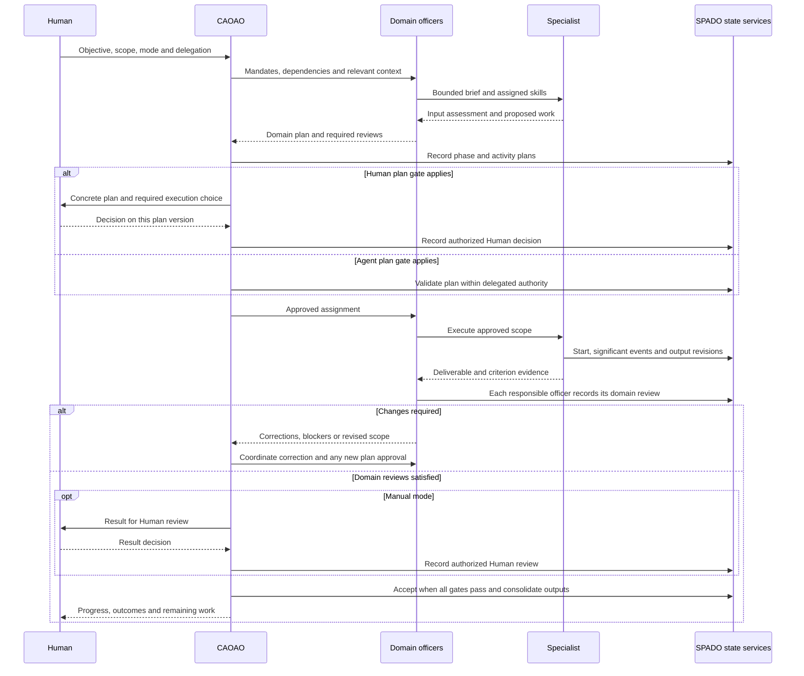

# SPADO Architecture

For installation, command syntax and operating procedures, see the [usage manual](USAGE.md). The [repository coherence review](docs/manual/coherence.md) distinguishes current implementation, historical CWI material and outstanding limitations; this document describes the common operating model.

SPADO (Software Product Agentic Development Organization) provisions coding agents to work as a **C-organization**. Agents have executive or specialist responsibilities, skills model their behavior, and workflows coordinate their assignments and decisions.

This document defines the common operating model for SPADO workflows and describes its current implementation. Full SPDLC is the first available workflow. Its phase numbering, deliverables and lifecycle decisions are workflow-specific applications of this model. The [README](README.MD) introduces the product and installation.

## 1. Concepts and responsibilities

| Concept | Meaning and responsibility |
|---|---|
| Host | The coding-agent application that runs sessions, native agents and tools. Current adapters support Claude Code and Codex. Host permissions continue to apply. |
| Organization | The defined orchestrator, domain officers, specialists, mandates and skill assignments used by a workflow. |
| Agent definition | A reusable role configuration containing a name, mandate, level, skills and assigned subphases. |
| Agent instance / actor | An authenticated identity registered for an execution, with its own ID, delegated scope and parent identity. Role titles alone do not grant authority. |
| Skill | Instructions and supporting resources that model an agent's behavior for its role or assignment. |
| Tools, scripts and MCP | Capabilities used by agents to inspect evidence, perform authorized actions and interact with systems. Tools operate under the agent's assignment and host permissions. |
| Workflow | A versioned definition that references its organization and describes phases, subphases, dependencies and expected outcomes. |
| Phase | A coherent group of subphases with an overall purpose and a phase plan when executed as part of a phase or full-workflow run. |
| Subphase | A reusable execution brief: inputs, responsibilities, deliverable, exit criteria and possible next steps. |
| Activity | One concrete execution of a subphase. Repeated work creates linked instances; activity is not an additional task hierarchy. |
| Run | An execution with a unique ID, objective, selected scope, modes, definition snapshots, activities and recorded evidence. |

Each workflow declares its organization. The selected scope determines which officer decisions and specialist assignments are needed. All required decision domains must be covered before their dependent work can be accepted.

The host performs agent execution. SPADO supplies catalog resources, identities, validated state transitions and shared evidence. CAOAO's planning and delegation occur through host agents; the current CLI does not independently schedule agent sessions.

## 2. Organization and authority

### Chief [Role] Agentic Officers

A **Chief [Role] Agentic Officer** leads a business or technical domain across the relevant activities and iterations. These officers are collectively called **C-Agents**. Their mandates define what they own, what they may delegate and which decisions require another domain's review.

The acronym inserts **A** for **Agentic** immediately before the final **O** of the corresponding traditional title. Compound roles retain all initials.

| Traditional role | C-Agent | Full title | Decision domain |
|---|---|---|---|
| CEO | CEAO | Chief Executive Agentic Officer | Business direction, strategic priorities, material investment and product lifecycle decisions. |
| CPO | CPAO | Chief Product Agentic Officer | Product strategy, discovery, scope, prioritization, customer value and product acceptance. |
| CTO | CTAO | Chief Technology Agentic Officer | Technical feasibility, architecture, engineering, technical release readiness and technical operations. |
| CMO | CMAO | Chief Marketing Agentic Officer | Positioning, brand, go-to-market strategy, acquisition and lifecycle marketing. |
| CFO | CFAO | Chief Financial Agentic Officer | Financial planning, economic viability, budgets, unit economics and financial controls. |
| COO | COAO | Chief Operating Agentic Officer | Service operations, support, operational readiness, customer transition and operational closure. |
| CRO | CRAO | Chief Revenue Agentic Officer | Sales strategy, revenue operations and renewals where a separate revenue function is applicable. |
| CISO | CISAO | Chief Information Security Agentic Officer | Security oversight, assessments, security-risk decisions within its mandate and security response. |
| CLO | CLAO | Chief Legal Agentic Officer | Legal and contractual assessments and readiness, coordinating with the designated privacy owner. |

**CAOAO — Chief Agent Orchestrator Agentic Officer** uses `Agent Orchestrator` as its role. CAOAO coordinates execution across these domains. CEAO owns business direction within its mandate. A CEAO business decision does not replace a required product, technical, financial, security or other domain review.

The table describes the current officer vocabulary. Workflow definitions assign the applicable roles to each subphase; additional executive functions require an explicit mandate and assignment.

### Levels, mandates and delegation

The operating hierarchy is **Human → CAOAO → C-Agents → Specialists**. Deliverables, decisions and escalations return through the assigned lead to CAOAO.

| Level | Responsibility | Authority and boundaries |
|---|---|---|
| Human | Sets objectives, constraints, scope and participation mode; may contribute to any activity. | Delegates authority and provides actual Human decisions where required. |
| CAOAO | Plans execution, coordinates officers and dependencies, distributes context and consolidates outcomes. | Registers assignments and validates coordination gates; cannot replace another officer's required domain decision. |
| C-Agent | Maintains domain direction, commissions specialist work and evaluates evidence. | Decides only within its mandate and assigned domains; refers unresolved cross-domain issues to CAOAO. |
| Specialist | Executes a bounded brief and produces deliverables and criterion evidence. | Works within its registered assignment; requests supporting expertise through its lead. Performing the work does not confer acceptance authority. |

Before delegation, establish the officer's mission, outcomes, responsible subphases, decision limits, available capabilities, specialist assignments, collaborators and continuity context. The activity brief identifies one Operational Owner who coordinates delivery and the responsible officers who decide on its outcome.

The Human registers CAOAO for a run. CAOAO can register officers and specialist assignments; an officer can register specialists within its delegated domain. This registration mechanism supports the hierarchy without requiring every supporting identity to be created by the officer personally. Each decision remains attributable to the actor exercising that role.

A replacement agent receives the current mandate, relevant artifacts, decisions and unresolved work. Previous records retain their original author identity. Agents may not silently enlarge their mandate, invent missing approvals or act as another participant.

### Execution, review, acceptance and consolidation

These are distinct responsibilities:

- **Execution:** the assigned specialist or the agreed Human participant performs the work and supplies evidence.
- **Domain review:** each required officer records an explicit approval or request for changes within its domain.
- **Acceptance:** CAOAO or the Human records acceptance after the plan, inputs, criteria and applicable reviews satisfy the gates.
- **Consolidation:** CAOAO updates the shared plan, distributes decisions and promotes accepted outputs into official context.

CAOAO coordinates conflicts through the named decision owners. A title, completed upstream task or silence does not satisfy a missing review. Human-produced work follows the same domain and evidence requirements.

## 3. How to use workflows

### Choose scope, mode and execution

Select an objective, a full workflow or independent phase/subphase, and a participation mode. Initial configuration supplies defaults; an explicit invocation may select a mode for its scope.

Use an explicit run ID when the conversation does not unambiguously identify the execution. In the host entry skills, `--run ID` selects an existing run and `--new-run` requests a separate execution. The CLI creates runs through `spado workflow create`. Reusing an execution retains its original scope and history; targeting work outside that scope requires an independent run.

Current Full SPDLC entry points are `/spdlc` in Claude Code and `$spdlc` in Codex. Both accept scope and mode instructions through the entry skill. These host invocations are translated into CLI operations and native delegation. Additional workflow entry points require their own definitions and adapter support.

### Follow dependencies and preserve history

A full workflow progresses by phase by default. Inside a phase, input dependencies determine which work is ready; subphase IDs are stable references rather than a complete execution schedule.

Explicit advances within a full run retain the whole workflow map. Record the reason, skipped work, missing inputs and assumptions, then return to the pending main sequence. SPADO does not silently execute omitted prerequisites.

Independent phases and subphases still need suitable inputs. Existing project documentation can supply external evidence when its revision is official and the authorized domain officer or Human records its suitability. Missing inputs may permit bounded provisional work with explicit assumptions; acceptance waits for resolved dependencies, a revised plan against the available evidence and the required reviews.

A phase plan precedes execution within a phase or full-workflow run. Every activity has its own plan. A direct subphase run needs only the activity plan. Plans identify the objective, deliverable, actions, revision IDs and hashes, dependencies, assumptions and acceptance criteria. Approval applies to a particular plan ID and version.

Resume unfinished work when appropriate; a fresh iteration creates a linked activity instance. Reusing accepted work from a prior phase cycle must be explicit in the new phase plan. N/A requires a justified applicability decision by the responsible domains; missing evidence or unfinished work cannot be relabelled N/A.

**Full SPDLC examples:** subphase 3.12 provides brand direction for 3.5 despite its higher number. Phase 6 closes individual operational cycles; phase 7 requires a recorded CEAO retirement decision. These numbers and decisions belong to SPDLC, not to every workflow.

### Common execution-brief fields

| Field | Meaning |
|---|---|
| Description | Work to perform and the problem it addresses. |
| Final Responsible | Officer or named decision owner accountable for the outcome; multiple owners retain distinct domains. |
| Operational Owner | One named participant coordinating the activity's execution and delivery. |
| Who executes | Specialist roles and any agreed Human contribution. |
| Inputs | Information, artifacts and evidence needed for the work, with identifiable versions and review status. |
| Dependencies | Required upstream evidence, parallel-work relationships and sequencing conditions. |
| Deliverable | The concrete output and supporting evidence expected. |
| Exit criteria | Observable conditions and required checks for accepting the activity's scope. |
| Decision / next step | Routes for continuation, correction, escalation or stopping. |
| Applicability | Conditions under which the work is required and the justification for any N/A decision. |

The instantiated brief also includes the run, activity and actor IDs, scope, mode, mandate reference, intended recipients and known limitations. Product-specific criteria must be established before evaluation and retained with their evidence and history.

## 4. Human participation and modes

The Human may voluntarily provide information, request changes, work alongside an agent or take over an activity in every mode. Record the agreed contribution and adjust the affected plan. Voluntary participation does not introduce a mandatory Human gate into `agentic`.

| Mode | Before execution | During work and at closure |
|---|---|---|
| `agentic` | Authorized agents validate the versioned plan. | Agents make workflow decisions and perform domain reviews. No Human approval is requested or required during execution. |
| `auto` | Agents validate the plan unless a necessary Human decision is missing. | Ask only for information, authority or an action that agents cannot resolve within their capabilities and delegation. No routine Human checkpoint. |
| `semi-auto` | The Human approves each phase/activity plan before the corresponding execution. | Agents execute, review and accept. Material plan revisions need new Human approval; no routine Human result checkpoint. |
| `manual` | The Human approves the plan and chooses Human execution, assistance or delegation for the activity. | Required domain reviews still apply, followed by Human result review before closure. |

A step is a phase or activity as applicable to the selected scope, not every internal action or tool call. Plan approval and result acceptance are separate events. Silence does not satisfy an approval gate.

In `agentic`, unavailable inputs or authority produce a recorded blocker without requesting Human approval or silently changing modes. In `auto`, questions identify the exact missing input or decision and why the agents cannot resolve it. Independent authorized work can continue if its own gates are satisfied.

Explicit Human mode changes identify the affected scope. They do not retroactively approve work or erase earlier decisions. All modes preserve domain reviews, evidence requirements and host permissions.

## 5. The agent execution cycle

1. **Receive identity and mandate.** Use the registered actor and delegated credential for the selected run; establish the applicable role and limits.
2. **Obtain scoped context.** Read assigned skills, workflow rules, the versioned subphase brief, current plan and authorized evidence.
3. **Check inputs and prepare the plan.** Identify dependencies, versions, deliverable, criteria, missing evidence and any provisional assumptions. CAOAO coordinates submission of the plan.
4. **Satisfy the plan gate.** Obtain the agent or Human decision required by the mode. Record the execution arrangement in manual mode.
5. **Execute and record.** Perform the bounded assignment, record significant progress and decisions, and synchronize deliverable files into revision records.
6. **Deliver and review.** Return output revision IDs, criterion evidence, limitations and next-step recommendations. Each responsible officer records its own conclusion.
7. **Accept or correct.** Request changes or revise the plan where necessary; accept only when all applicable gates pass.
8. **Consolidate and continue.** Update shared state, promote accepted documentation where appropriate and distribute the resulting context to dependent assignments.



The diagram shows the logical coordination flow. A Human decision must come from the actual Human; an agent cannot manufacture it by using a Human credential. Native host agents perform the work, and the same state services validate records from the CLI and script facade.

## 6. Scripts and execution records

### Interfaces and identity

The installed facade is `.spado/tools/agent-record.py`, sourced from [agent-record.py](catalog/workflows/tools/agent-record.py). Run it with the Python environment containing SPADO.

| Operation | Purpose and access |
|---|---|
| `record --run RUN_ID --request FILE` | Submit an event using the actor's credential. The event kind and delegated scope determine authorization. |
| `status --run RUN_ID` | Read consolidated run state; restricted to coordinator authority. Specialists use scoped workflow context and reviews. |

Both operations accept `--root` for the configured project. The Python functions `record(root, run_id, request)` and `read_status(root, run_id)` expose the same facade. The corresponding CLI write is `spado workflow record --run RUN_ID --request FILE`.

Credentials come from `SPADO_ACTOR_TOKEN_FILE` or `SPADO_ACTOR_TOKEN`. `spado actor create` returns the new actor identity and a private token-file path; give that path only to its assigned session. A claimed role in JSON does not authenticate the request. The facade never falls back to the Human credential. CLI `--human` represents a real Human action or explicitly authorized initial delegation.

### What to record

Record significant assignments, starts, plans, approvals, execution decisions, output revisions, blockers, questions, handoffs, Human contributions and closure. The event and referenced state together must identify:

- Who acted, in which role, run, activity and scope, and who requested the work.
- The objective, action or decision, input references and a concise evidence-based rationale.
- The resulting artifacts, checks, limitations, recipients, status and next action.
- The applicable plan and revision versions, and the actual decision owner where approval is required.

SPADO supplies authenticated actor identity and event timestamps. Records describe observable actions and decision rationales; they do not contain private internal reasoning, credentials or invented results. Read-only consultation is exempt from execution logging.

A request contains `event_id`, `kind`, `payload` and `rationale`, with optional `expected_version` for stale-state detection. The [state protocol](src/spado/runtime/protocol.md), installed as `.spado/protocol.md`, defines each payload and its authority requirements. A narrative note cannot replace a required plan approval, delivery or domain review event.

### Example: record a coordination decision

This example assumes project setup and `spado db up` are complete, a run exists, and its CAOAO actor has been delegated. Use the actual returned run ID and token-file path. Save this as `coordination-note.json` in the configured project:

```json
{
  "event_id": "37e2044b-65f2-43c2-952c-780c9dfda735",
  "kind": "note",
  "payload": {
    "category": "decision",
    "message": "Product, technology and finance will each provide their domain conclusion before consolidation."
  },
  "rationale": "The selected work requires separate domain reviews before acceptance."
}
```

With that session's credential configured:

```bash
export SPADO_RUN_ID="REPLACE_WITH_RUN_ID"
export SPADO_ACTOR_TOKEN_FILE="/absolute/path/returned-for-the-caoao-actor.token"

python .spado/tools/agent-record.py record --run "$SPADO_RUN_ID" --request coordination-note.json
python .spado/tools/agent-record.py status --run "$SPADO_RUN_ID"
```

Generate a fresh UUID for each new event. Keep the same event ID, actor, run and content when retrying an identical request: it returns the recorded result without duplicating the transition. Reusing an ID for different content is rejected. If the expected run version is stale, refresh context and reassess the intended action before submitting a new request.

### Failures and handoffs

A failed write must not be reported as completed. The facade reports `persisted: false` and a pending status on recording failures; a failed status read is unavailable. Return the original structured request and failure information to CAOAO. CAOAO tracks resolution and arranges a retry under the original authorized identity, or a separately attributed follow-up action.

The pending response does not create a durable retry queue. Preserve the request through the agreed handoff. Approval and persistence gates remain unsatisfied until a successful service response confirms the transition.

## 7. Context, state and official documentation

### Access by organizational level

| Level | Read context | Write responsibility |
|---|---|---|
| Human | Project and run context, official documentation and consolidated history. | Objectives, delegation and authorized Human decisions; may participate in workflow transitions subject to their gates. |
| CAOAO | Full run context and shared event history. | Coordination plans, assignments, acceptance, consolidation and promotion of accepted outputs. |
| C-Agent | Authorized domain context, relevant plans, assigned artifacts and shared official documentation. | Domain decisions and reviews, scoped documentation, notes and permitted specialist delegation. |
| Specialist | Assigned activity context, relevant plans and shared official documentation. | Its assigned execution, output revisions, delivery and scoped notes; no promotion or domain self-approval. |

CAOAO is the agent responsible for reading and consolidating the shared event log. The Human can inspect it. Other agents receive scoped context through briefs, handoffs and authorized queries. Access to official documentation does not grant access to every draft or authority to change it.

Each actor is bound to its project and delegated run. Application permissions assume a trusted local machine; they do not isolate a process that can read the database administrator's credentials.

### Documents, versions and impact

Project files are the documentation source of truth. PostgreSQL preserves immutable revision content, hashes, author identities and dependency links alongside approval history. Editing a file creates a candidate on synchronization; the previous approved revision remains official until explicit promotion.

Accepted activity outputs can be promoted by CAOAO or the Human. Initial external documentation requires Human attestation. Promotion establishes official context; it does not replace the reviews needed to accept workflow-produced outputs.

`spado docs sync` records file revisions. Pre-execution synchronization also checks recorded files before mutation commands; an actor encountering changed required inputs outside its authority must involve the coordinator. Changes invalidate recorded consumers and revoke stale approvals, including affected phase plans. Revised plans and applicable reviews are needed before the affected work can be accepted again.

Runs snapshot workflow rules, full briefs and organization definitions with a workflow content digest. Catalog edits do not silently rewrite existing executions. Prior phase-cycle work counts in a new cycle only when the approved plan explicitly reuses it.

### Persistence and retrieval

PostgreSQL with pgvector runs in a project-specific local Docker Compose container with a persistent volume. Versionable configuration lives under `.spado/`; private credentials live under `.spado/local/`. `spado db down` stops the container without requesting volume deletion.

Each successful record transaction updates the run and appends its event under a row lock. Explicit sequence values preserve activity and revision chronology. Optional expected versions detect stale writes; stable event IDs make retries idempotent.

Embeddings can be local or external. The external adapter sends indexed text and search queries to the configured OpenAI-compatible endpoint. Official search filters by project, run, current approved revisions and model identity. A model change needs indexing with the new identity; missing indexes are reported. Relational state determines permissions and gates, while vector retrieval helps locate evidence.

### Status, review and conversation

The `/spado` and `$spado` entry skills provide:

- **Status:** the last recorded execution state, scope, plans and activity instances; it is not live process telemetry.
- **Review:** dependency and state findings for all work, a phase, subphase or activity. Responsible agents assess semantic contradictions against the evidence.
- **Conversation:** discussion of authorized scopes and possible changes without applying them; moving from a proposal to execution requires an explicit execution instruction.

These consultations do not create runs, approve plans, synchronize files, index content or persist events. Review can report external file differences without importing them. Search may call the configured embedding provider to encode a query but does not rebuild the index.

Impact analysis covers recorded relationships. Unrecorded dependencies and semantic consistency still require domain review.

## 8. Current implementation and extension

### Components

| Subsystem | Implementation | Responsibility |
|---|---|---|
| Canonical catalog | `catalog/workflows/spdlc`, `catalog/organizations/spdlc`, `catalog/organization-skills` | Workflow rules and briefs, organization mandates and behavior skills; the full SPDLC document is generated. |
| Domain | `src/spado/workflows` | Modes, scopes, versioned plans, gates, reviews and impact invalidation. |
| State services | `src/spado/runtime/store.py` | Authenticated identities, PostgreSQL transactions, snapshots, event history and concurrency. |
| Documentation | `src/spado/runtime/commands.py` | File synchronization, promotion, context and inspection commands. |
| Retrieval | `src/spado/runtime/embeddings.py` | Local/external embeddings, provenance and pgvector retrieval. |
| Host adapters | `src/spado/adapters` | Native Claude/Codex agents and skills, explicit capability compatibility and additive MCP configuration. |
| Installation | `src/spado/runtime/install.py`, `src/spado/install` | Preview, ownership hashes, conflict checks, atomic writes and rollback. |
| Public interfaces | `spado` CLI and `agent-record.py` | Shared services for host agents and future interfaces. |

### How instructions reach agents

Workflow setup installs native agent definitions, their assigned skills, workflow catalog resources, the recording facade and the state protocol. The entry skill directs agents to installed workflow rules and `spado workflow context` for the selected run's versioned briefs and state.

This architecture document is the common design reference. Editing it alone does not update installed instructions or execution behavior. Applicable changes must be reflected deliberately in catalog rules, organization definitions, skills, adapters or services, then installed as appropriate. Existing run snapshots remain authoritative for those executions.

For current executable instructions, see the [SPDLC rules](catalog/workflows/spdlc/rules.md), [organization definition](catalog/organizations/spdlc/organization.json) and [state protocol](src/spado/runtime/protocol.md).

### Current scope and future work

The current configuration installs Full SPDLC for Claude Code and Codex, or selected standalone capabilities. Adding a future workflow requires its catalog definition, organization assignments, skills and entry-point support; the design is reusable, but additional workflows are not installed merely by naming them. Additional coding-agent hosts require reviewed adapters and compatible capabilities.

There is no autonomous agent scheduler or background filesystem watcher in v1. Host agents execute the assignments; explicit synchronization and pre-execution checks handle document changes.

A future Human UI can display the workflow map, decisions, plans and approved documentation and submit edits through the same services. It must preserve identities, modes, revision history and impact checks. The UI is deferred; the CLI and host entry skills are the current interfaces.
